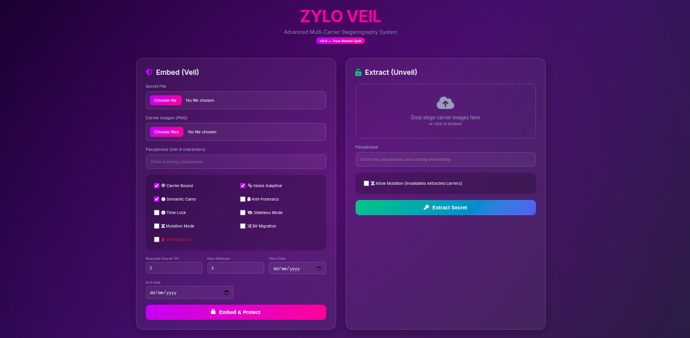
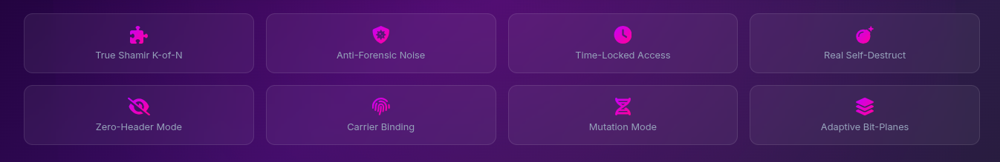

# ZYLO VEIL


> **Experimental Cryptographic Steganography with Distributed, Adaptive, and Destructive Properties**

ZYLO VEIL is a research‑grade cryptographic steganography system designed to explore what happens when modern cryptography, adaptive signal analysis, and adversarial threat models are combined at the stego layer itself. Rather than treating steganography as simple data hiding, ZYLO VEIL treats the carrier image as a cryptographic substrate: payloads are encrypted, optionally split across multiple carriers using threshold secret sharing, adaptively embedded based on local noise characteristics, and protected with anti‑forensic countermeasures. The system further introduces carrier binding, temporal fragility, self‑destruct behavior, and stego mutation, making extraction dependent not only on the correct key but also on time, carrier integrity, and extraction history.

This repository intentionally contains a single, large Python file (≈2500 lines) that implements the entire system end‑to‑end. There are no external services, no databases, and no Git submodules—everything required to study, audit, and experiment with the design is self‑contained and transparent in one place.


<p align="center">
  
</p>

<p align="center">
  
</p>

---

## ⚠️ Important Notice

This project is **experimental** and intended for **education, research, and defensive study** of steganography and steganalysis.

It is **not** marketed as “unbreakable.” Instead, it explicitly documents its threat model and design trade‑offs.

---

## Core Capabilities (What Makes ZYLO VEIL Different)

### 1️⃣ Multi‑Carrier Split Payload (Optional, Shamir‑Style)

* Payload is **encrypted first**, then split using **Shamir’s Secret Sharing (K‑of‑N)**.
* Each carrier image embeds **only one share**.
* A single image is cryptographically useless unless K shares are collected.
* **Optional**: set K=1 to use a single carrier image (classic mode).

This makes ZYLO VEIL a **distributed steganographic vault**, not just a file hider.

---

### 2️⃣ Adaptive Noise & Semantic‑Aware Embedding

* Embedding capacity is computed per pixel using:

  * edge/noise estimation
  * pseudo‑random bias
  * optional semantic camouflage heuristics
* Smooth regions get fewer bits; noisy regions get more.

This breaks many statistical steganalysis assumptions.

---

### 3️⃣ Anti‑Forensic Stego Poisoning

After embedding, unused pixel channels are deliberately perturbed to:

* mimic camera sensor noise
* destroy clean statistical signatures
* introduce decoy entropy

This is **anti‑forensics**, not just hiding.

---

### 4️⃣ Stateless Extraction Mode (Zero‑Header)

Optional mode where:

* **No magic bytes**
* **No explicit header**
* All parameters are derived from:

  * passphrase
  * carrier fingerprint
  * algorithm version

Without the exact carrier + passphrase + algorithm, extraction is impossible.

---

### 5️⃣ Bit‑Plane Migration (Temporal Fragility)

* Embedding bit‑planes migrate deterministically over time.
* Old copies of the same stego image become undecodable.
* Screenshots or delayed exfiltration fail.

This introduces **time‑bound decay** into steganography.

---

### 6️⃣ Self‑Destruct & Attempt Limiting

* Optional extraction attempt counter.
* After N failed attempts:

  * embedded bits are **irreversibly poisoned**
  * carrier is permanently destroyed

---

### 7️⃣ Stego Mutation on Extraction

* On successful extraction, payload can be **re‑embedded differently**.
* Seeds, salts, and permutations rotate.
* Old copies become invalid.

The image becomes a **living container**.

---

### 8️⃣ Formal Threat Model (By Design)

ZYLO VEIL explicitly considers:

**Defends Against**

* casual inspection
* LSB plane visualization
* naive steganalysis
* partial carrier compromise
* replay of old stego copies

**Does NOT Defend Against**

* full plaintext knowledge of both carrier and payload
* active image recompression
* hostile ML models trained specifically on this algorithm

---

## Architecture Overview

```
[ Secret File ]
      ↓
[ LZMA Compression ]
      ↓
[ AES‑GCM Encryption ]
      ↓
[ Shamir Split (Optional) ]
      ↓
[ Adaptive Stego Embed ] → PNG Carriers
```

Extraction reverses the process **only if constraints are satisfied**.

---

## Running the Project

### Requirements

* Python 3.10+
* Pillow
* cryptography **or** pycryptodome
* argon2‑cffi (optional but recommended)

Install:

```bash
pip install pillow cryptography argon2-cffi
```

---

## Launch (Web UI)

The single Python file exposes a Flask‑based UI.

```bash
python ZYLOVEIL.py
```

Then open:

```
http://127.0.0.1:5000
```

---

## Example: Single‑Image Mode (K = 1)

1. Select a secret file
2. Select **one** carrier image
3. Set **K = 1**
4. Provide passphrase
5. Embed

Result: one PNG containing the encrypted payload.

---

## Example: Multi‑Carrier Mode (K‑of‑N)

* Carriers: 5 images
* Threshold: K = 3

Any 3 of the 5 images are required to recover the payload.

---

## Carrier Image Example

The repository includes a sample carrier image:

```
ZYLO~ZENTRA.png
```

This image is visually clean and suitable for testing adaptive embedding.

## File Size

The maxium size of the file that can be embeded depends on the size of the carrier image/s.
To get higher space, one may increase the carrier image's size from [here](https://image.pi7.org/increase-image-size-in-kb).

---

## File Layout

```
README.md
ZYLOVEIL.py        # Entire system (≈2500 lines)
ZYLO~ZENTRA.png   # Example carrier image
```

---

## Why This Repo Matters

Most steganography tools:

* hide bytes
* use fixed LSBs
* assume static extraction

ZYLO VEIL explores **cryptographic steganography**:

* carrier‑bound
* time‑fragile
* distributed
* self‑destructive
* mutation‑capable

This places it closer to **research prototypes** than consumer tools.

---

## Final Disclaimer

Do not use this project for illegal activity.

Use it to:

* learn
* experiment
* understand steganography limits
* build better detection tools

---

**Author:** Swapnanil Guin

**Project Codename:** ZYLO VEIL

**Status:** Experimental / Research‑grade
